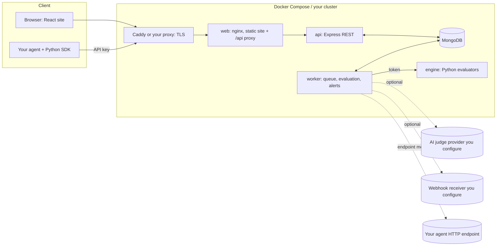
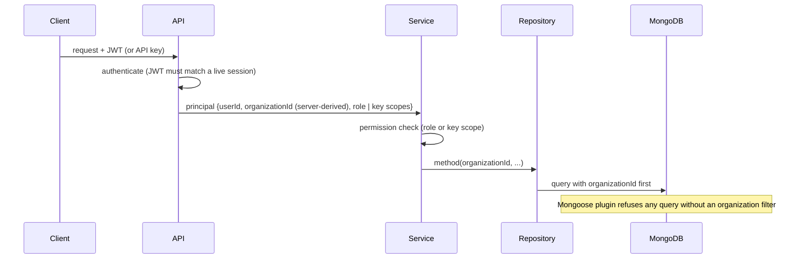
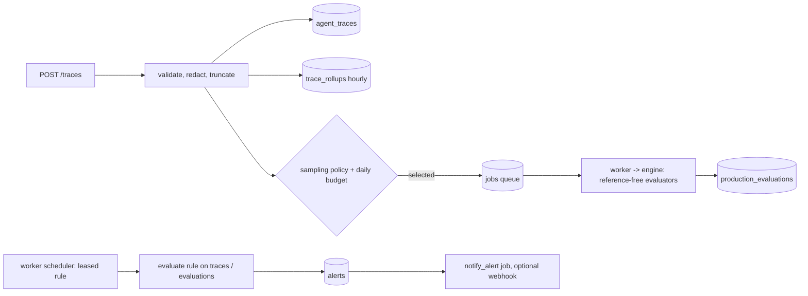

# AgentEval Architecture

How AgentEval is built, how data flows through it, and why it is built that way. Written from the code of version 0.6.0

**Contents**
1. [System overview](#1-system-overview)
2. [Components](#2-components)
3. [Request path and tenant isolation](#3-request-path-and-tenant-isolation)
4. [Data flows](#4-data-flows)
5. [Code layout](#5-code-layout)
6. [Data model (MongoDB)](#6-data-model-mongodb)
7. [Background processing](#7-background-processing)
8. [Evaluators: how scores are computed](#8-evaluators-how-scores-are-computed)
9. [The debugging engine](#9-the-debugging-engine)
10. [Monitoring and alerting internals](#10-monitoring-and-alerting-internals)
11. [Security architecture](#11-security-architecture)
12. [Frontend](#12-frontend)
13. [Deployment shape](#13-deployment-shape)
14. [Key design decisions](#14-key-design-decisions)
15. [Known limits of the design](#15-known-limits-of-the-design)
16. [Status and roadmap](#16-status-and-roadmap)

---

## 1. System overview

AgentEval is a self-hosted quality-engineering platform for AI agents. It records every agent run as a **trace**, scores what the agent **said** and **did**, explains why a run went wrong, samples live traffic, and raises alerts when quality, cost or reliability degrades.



Only the proxy (or `web` in local mode) is exposed. MongoDB and the engine live on the private Docker network; the API is bound to `127.0.0.1`. There is no vendor control plane, licence check or telemetry: the only outbound calls go to the AI-judge provider, webhook URLs and agent endpoints **you** configure.

## 2. Components

| Component | Location | Technology | Role |
|---|---|---|---|
| **web** | `apps/web` | React 18, Vite 5, Tailwind 3, Recharts, hash router; nginx (unprivileged) in production | Dashboard, traces, debug view, suites, runs, monitoring, alerts, organization, evaluator settings |
| **api** | `apps/api` (`src/index.js`) | Node 20+, Express 4, Mongoose 8, Helmet, express-rate-limit | REST API `/api/v1`: auth, tenancy, ingestion, suites, evaluations, analytics, monitoring, alerts, organization |
| **worker** | `apps/api` (`src/worker.js`, same image as api) | Node | Claims jobs from MongoDB; runs evaluations (calls the engine, your agent, the judge); evaluates sampled production traces; schedules alert rules; sends webhooks; sweeps expired SDK runs |
| **engine** | `evaluation-engine` | Python standard library only (`http.server`), no dependencies | `POST /v1/evaluate`, `POST /v1/debug`, `GET /v1/evaluators`; private network, guarded by `ENGINE_TOKEN` |
| **sdk** | `sdk/python` | Python standard library; optional LangChain/LangGraph | Builds normalized traces, redacts, batches, retries; drives SDK-mode runs; registers agents |
| **MongoDB** | container or managed | MongoDB 7 (5.0+ needed for `$dateTrunc`) | All data, the job queue, rollups; TTL-based retention |
| **trace-schema** | `packages/trace-schema` | JSON fixtures | The shared contract both validators must satisfy |

Node dependencies are deliberately few: the API uses only `express`, `cors`, `helmet`, `express-rate-limit`, `mongoose`. Password hashing, JWT, AES-GCM and HMAC use `node:crypto`.

## 3. Request path and tenant isolation



**Middleware order** (`app.js`): request id → Helmet → CORS allow-list → global rate limit (300/min/IP) → `/api/v1/health` → authenticated router → 404 → error handler. In the router, auth endpoints get a strict limiter (counts only failed attempts); trace endpoints authenticate **before** parsing the larger body.

**Principals.** `{type:"user", userId, organizationId, role, sessionId}` or `{type:"apiKey", keyId, organizationId, agentId|null, scopes}`. The organization is **always derived server-side**: from the key record, or from verified membership (header `X-Organization-Id` is only a selector that is checked against membership).

**Three isolation layers**

1. The organization comes from the authenticated principal, never from request data.
2. Every repository method takes `organizationId` first and puts it in the filter.
3. A Mongoose plugin (`models/tenantPlugin.js`) fails closed on any query on a tenant collection without an equality match on `organizationId`, and every aggregation pipeline must start with a tenant `$match` (unit-tested). The route sweep test calls every route as a different organization.

Deliberate cross-tenant paths: sessions, login throttles, and one-time-token lookups by secret hash.

## 4. Data flows

### 4.1 Trace to alert



Ingestion steps (`traces.service.js`): permission → schema validation (`422 INVALID_TRACE`) → agent lookup → sanitize/redact + size limit → insert if absent (idempotent on `(organizationId, traceId)`) → mark agent connected, register version → monitoring hook (rollup + sampling; never throws) → optionally link to an SDK evaluation run.

### 4.2 Evaluation run

1. A member creates a run (`POST /evaluations`) for an agent and a suite. Evaluator versions and configs are **pinned**; the case ids are frozen into the run.
2. **SDK mode:** the run waits in `awaiting_traces`. The developer's code fetches pending cases (`GET /evaluations/:id/work`), runs the agent, and sends traces tagged `metadata.evaluation = {runId, testCaseId}`. Ingestion links each trace and enqueues an `evaluate_case` job. No inbound network surface is needed. Cases whose trace never arrives before the deadline (30 min) become `error` results, so the run always finishes.
3. **Endpoint mode:** the API enqueues one `evaluate_case` job per case. The worker calls the agent's HTTP endpoint through the guarded client, stores the returned (or synthesized) trace with environment `evaluation`.
4. The worker sends `{trace, testCase, evaluators, judge?, limits}` to the engine. Results are normalized (`score`, `confidence`, `threshold`, `status`, `findings`, `evaluatorVersion`, `meta.configHash`) and stored idempotently (unique on run + case).
5. Judge budget is **reserved atomically** before the call (parallel workers cannot overspend; at most 8 calls per case) and the unused part is refunded.
6. When `completed == total` the run is finalized with `summary` (see [API_DOCS §7](API_DOCS.md#7-evaluators-and-evaluation-runs)).

### 4.3 Production monitoring

Hourly rollups (counts, errors, durations, tokens, cost, latency histogram) are written on every ingest, so dashboards never scan raw traces for long ranges. A per-agent policy decides which production traces are evaluated in the background with reference-free evaluators, under hard daily budgets.

## 5. Code layout

```text
agent/
├── apps/
│   ├── api/
│   │   ├── src/
│   │   │   ├── index.js, worker.js, app.js, composition.js   entry points; composition wires services
│   │   │   ├── routes/index.js        the complete route table (HTTP only)
│   │   │   ├── services/              business rules (auth, agents, apiKeys, traces, testSuites, evaluations,
│   │   │   │                          evaluationExecutor, analytics, monitoring, alerts, alertEngine, alertNotifier,
│   │   │   │                          productionEvaluator, org, debug, evaluatorConfig, audit, workerLoop, jobRouter)
│   │   │   ├── repos/mongo.js         MongoDB implementation of every repository
│   │   │   ├── modules/               pure logic: traces (schema, document), testSuites/importers, evaluations/aggregate,
│   │   │   │                          analytics/pipelines, monitoring (policy, sampling, histogram, health, windowStats),
│   │   │   │                          alerts (rules, lifecycle), health routes
│   │   │   ├── models/                Mongoose schemas + tenant plugin
│   │   │   ├── lib/                   crypto, jwt, secretbox, rbac, ssrf, safeHttp, redact, validate, engineClient, tenant
│   │   │   ├── middleware/            auth, errors, http helpers
│   │   │   └── config/                env parsing, evaluator catalogue JSON
│   │   └── test/                      unit/, integration/, helpers/ (in-memory repositories)
│   └── web/                           React app (src/pages, src/components, src/api.js), nginx.conf, Dockerfile
├── evaluation-engine/src/agenteval_engine/
│   ├── server.py                      HTTP service
│   ├── engine.py                      orchestration: payload → results
│   ├── evaluators/                    accuracy, completeness, grounding (hallucination+groundedness), instructions,
│   │                                  operational, relevance, tools
│   ├── claims.py, text.py             claim extraction/matching, number-aware text utilities
│   ├── judge.py                       provider-independent LLM-judge layer
│   ├── debug.py                       debugging engine
│   └── result.py                      normalized result type
├── sdk/python/src/agenteval/          client, transport, builder, trace validator, redact, integrations
├── packages/trace-schema/fixtures/    shared contract fixtures
├── deploy/                            caddy/, nginx/, scripts/ (backup, restore)
├── scripts/                           init-env, doctor, verify, run-engine, loadtest-ingest, simulate_live_traffic
└── docker-compose{,.dev,.prod}.yml
```

**Layering rule:** routes call services; services call repository *interfaces*; `repos/mongo.js` implements them, and `test/helpers/memoryRepos.js` is an in-memory twin with the same methods, so business rules are unit-tested with no database. Pure logic in `modules/` takes the clock as an argument.

## 6. Data model (MongoDB)

Database `agenteval`, 21 collections. Every tenant-scoped document carries an immutable `organizationId`.

| Collection | Holds | Notable indexes / retention |
|---|---|---|
| `users` | e-mail, name, scrypt password hash | unique e-mail |
| `organizations` | name, `members[{userId, role}]` embedded, `settings.traceRetentionDays` | index on `members.userId` |
| `agents` | name, framework, integration type, endpoint URL, encrypted endpoint token, version, status, `monitoring` policy, archive flag | unique `(org, name)` among non-archived |
| `agent_versions` | per-agent versions (`manual` or from traces) | unique `(org, agent, version)` |
| `api_keys` | SHA-256 key hash, prefix, scopes, bound agent, expiry, revocation | unique key hash |
| `agent_traces` | sanitized trace incl. spans, previews, counters (`spanCount`, `llmCallCount`, `toolCallCount`, `hasError`), `isDemo`, `expiresAt` | unique `(org, traceId)`; several query indexes; **TTL on `expiresAt`** (org retention, default 90 days) |
| `test_suites`, `test_cases` | suites (unique name per org) and immutable cases (soft delete, ordered by `position`) | |
| `evaluator_configs` | one per org: judge settings with encrypted API key | unique per org |
| `evaluation_runs` | agent, suite, mode, pinned evaluators, limits, status, progress counters, case ids, deadline, summary | |
| `evaluation_results` | per case: metrics[], status, trace id, latency/tokens/cost, judge calls | unique `(org, run, case)` |
| `jobs` | the queue: type, payload, status, attempts, lease, `runAt`, idempotency key | unique `(org, idempotencyKey)`; finished jobs removed after 14 days |
| `trace_rollups` | hourly per agent/version/environment/demo, with latency histogram | unique key; TTL (400 days) |
| `usage_daily` | per agent per UTC day: evaluations queued/skipped, judge calls (atomic budget counters) | unique; TTL (35 days) |
| `production_evaluations` | results for sampled production traces | unique `(org, traceId)`; TTL follows the trace |
| `alert_rules`, `alerts` | rules (with per-rule state, encrypted webhook) and fired alerts | partial unique `(org, rule)` for open/acknowledged alerts; alerts TTL 365 days |
| `audit_logs` | who did what: ids, action, IP, small metadata (never secrets) | TTL 365 days |
| `sessions` | server-side sessions; refresh token **hash** | unique hash; TTL on expiry |
| `one_time_tokens` | invitation and password-reset tokens (hashes) | TTL a week past expiry |
| `login_throttles` | failed-login counters keyed by hash of e-mail | TTL |

Retention summary: traces by TTL (organization setting; applies to traces ingested after a change), rollups 400 days, alerts 365 days, audit 365 days, jobs 14 days.

## 7. Background processing

The worker (`workerLoop.js`) runs three timers:

| Timer | Interval | Does |
|---|---|---|
| Poll | `WORKER_POLL_MS` (1 s) | Claims jobs while fewer than `WORKER_CONCURRENCY` (2) are active. Claim is atomic with a 5-minute **lease**, so a crashed worker's job is picked up again |
| Sweep | 30 s | `sweepExpired`: SDK runs past their deadline get `error` results for missing cases |
| Alert scheduler | `ALERT_TICK_MS` (15 s) | Finds due alert rules (leased for 2 minutes so several workers do not double-evaluate), evaluates, applies the lifecycle, queues notifications |

Job types: `evaluate_case` (run case), `evaluate_trace` (sampled production trace), `notify_alert` (webhook). Jobs default to 3 attempts (webhooks 4) with exponential backoff (2 s base). The router retries retryable failures (engine unreachable, `408/429/5xx`, timeouts) and records final ones as `error` results; non-retryable errors (agent returns 4xx, invalid JSON, missing agent) are final immediately. Everything is idempotent: results are unique per run and case, production evaluations per trace, alerts per open rule, notification jobs per alert and event.

Graceful shutdown: `SIGTERM`/`SIGINT` stop timers, wait up to 10 s for active jobs, disconnect.

## 8. Evaluators: how scores are computed

Engine 0.4.0; all evaluators are version 1.0.0 (old versions stay registered so past runs can be reproduced).

Every evaluator returns the same normalized result: `metric, score (0-1), status (pass|fail|inconclusive), confidence (0-1), threshold, explanation, findings[], evaluatorVersion, meta{configHash,…}`.

**Score, confidence and threshold are separate.** `status` is derived: `inconclusive` if there is no score or `confidence < minConfidence` (default 0.5); otherwise `pass` if `score ≥ threshold`. Every evaluator accepts `threshold` and `minConfidence` in its config. **Rules run first; the optional LLM judge only refines what rules cannot decide**, and is never the only signal.

| Metric | Needs on the test case | Score | Default threshold | Judge | Config keys |
|---|---|---|---|---|---|
| **accuracy** | `referenceAnswer` | `auto` mode picks exact match (≤3 words), numeric (reference is just a number; tolerance default 1%) or semantic (0.6·recall + 0.4·F1 of content words; a reference number missing from the answer caps the score at 0.4). With judge: 70% judge + 30% lexical | 0.8 | yes | `mode` (auto/exact/numeric/semantic), `tolerance` |
| **hallucination** | `referenceEvidence`, or `referenceAnswer`, or tool/retrieval output in the trace | Claim-level: each claim is *supported / contradicted / unsupported / unverifiable*. Score = 1 − (contradicted + w·unsupported) / checkable, w = 0.5 (unsupported is not automatically false) | 0.8 | refines uncertain claims | `unsupportedWeight` |
| **groundedness** | evidence as above | supported claims / checkable claims (stricter: unsupported counts fully against it) | 0.7 | shared with hallucination | |
| **relevance** | the request | With judge: judge score. Without: refusal ⇒ fail; word overlap ⇒ weak score with confidence 0.4, so usually *inconclusive* | 0.6 | yes | |
| **completeness** | `requiredElements` (strings or `{text, alternatives}`) | covered / total (substring, number match, ≥80% content-word recall; the judge can only rescue a miss by quoting the answer) | 0.8 | yes | `elements` (extra elements) |
| **tool_usage** | `expectedToolCalls` (optional) + tool spans | weighted: selection .25, parameters .20, execution .15, interpretation .20, sequence .10, completion .10 (only applicable checks count). *Interpretation* flags answers that contradict tool output and points at the tool step | 0.8 | no | `forbidUnexpected`, `ordered` |
| **instruction_adherence** | `constraints` | share of satisfied checks: `maxChars`, `minChars`, `maxWords`, `mustInclude`, `mustNotInclude`, `format` (`json`, `single_line`, `bullet_list`) | 1.0 | no | |
| **operational** | config budgets | share of budgets met: `maxLatencyMs`, `maxTotalTokens`, `maxCostUsd`, `maxErrors`. **No built-in prices:** cost comes from `usage.estimatedCostUsd` or your `config.pricing` (`{model: {inputPer1M, outputPer1M}}`). No budgets ⇒ inconclusive (measurements still recorded in `meta`) | 1.0 | no | the budgets, `pricing` |

Confidence examples: 0.99 exact, 0.95 numeric, 0.55 lexical semantics, 0.65-0.85 with a judge; tool_usage 0.95 (0.85 when interpretation applies); instruction_adherence 0.97; operational 0.98.

**Case status** (API side): any metric `fail` ⇒ `failed`; else any `pass` ⇒ `passed`; else `inconclusive`; infrastructure problems ⇒ `error`.

**Reproducibility:** a run stores the exact evaluator versions and configs; results carry `evaluatorVersion` and `meta.configHash`; the engine is deterministic for the same input (judge output depends on your provider).

**AI judge layer (`judge.py`).** Providers: any OpenAI-compatible `chat/completions` server, or Anthropic `messages`. Standard library only. Safety rules: text from the system under test is wrapped in `<<<BEGIN …>>>` markers as untrusted data (embedded markers neutralized); the judge must reply with one JSON object; a "supported/covered" verdict counts **only if the judge quotes text that really exists in the material** (≥ 8 characters, normalized); clear rule-based contradictions are never sent to the judge; a per-request call budget stops runaway cost; redirects are not followed; the base URL must be public unless `ENGINE_ALLOW_PRIVATE_JUDGE_URLS=true`. **Limit:** score-type judge outputs (relevance 0-1) cannot be quote-verified and are trusted as returned.

## 9. The debugging engine

Question it answers: **where did this run go wrong, and what is the evidence?** Input: one stored trace (+ any evaluation results about it). It never inspects hidden reasoning and never claims a proven root cause.

| Certainty | Meaning | Examples |
|---|---|---|
| **observed** | A fact written in the trace | a step raised an error; an evaluator reported a failure |
| **likely** | Rule-based cross-check with strong evidence (confidence ≥ 0.85) | answer says 52,999, tool returned 47,999 |
| **possible** | A lead, not proof | a count differs from a key/value tool output; same tool called 3+ times with identical input; a tool returned nothing but the answer cites numbers |

Finding types: `span_error` (only the deepest failing step; ancestors that merely re-raised it are named in the text), `trace_error`, `swallowed_error`, `contradiction`, `unsupported_claim`, `empty_tool_output`, `repeated_call`, `slow_step` (a leaf step took ≥ 60% of the run and ≥ 2 s; info only), and, when evaluation data exists, `evaluation_finding`, `evaluation_check`, `metric_failed`. The same claim is not reported twice. Without evaluation data the engine lists `potentialMetrics` ("could affect, once evaluated") rather than pretending a metric failed. Every response carries caveats, always including "a suspicious step is a lead, not a proven root cause."

Honest numbers: on the bundled demo data (112 traces, 15 planted wrong answers, 8 tool failures) it flags 15 of 15 wrong answers and 0 of 89 healthy traces. That is a regression check on synthetic data with clean tool output, **not a benchmark**.

## 10. Monitoring and alerting internals

* **Sampling** (`modules/monitoring/sampling.js`): deterministic. A trace is selected when `hash(traceId) < sampleRate`, so a re-delivered trace gets the same decision. Reasons: `monitoring_off`, `not_production`, `demo`, `failed_execution` (when `alwaysEvaluateErrors`), `sampled`, `not_sampled`, `budget_exhausted`.
* **Budgets:** `usage_daily` counters are reserved with an atomic conditional update (queued traces against `dailyTraceBudget`; judge calls against `dailyJudgeBudget`, 8 per trace); unused judge calls are refunded. A judge always has a daily cap.
* **Rollups:** written at ingest, keyed `(org, agent, version, environment, isDemo, hour)`, including a latency histogram with edges 50, 100, 200, 400, 800, 1500, 3000, 6000, 12000, 30000, 60000 ms. Rollup p95 is the **upper bound of the bucket** containing the percentile; live p95 is exact over the newest 5,000 traces.
* **Health** (`health.js`): pure function with fixed thresholds (min 10 samples; degraded ≥ 5% errors, failing ≥ 25%; latency ≥ 2× previous window; ≥ 30% quality failures over 5+ results). Every verdict lists the numbers behind it.
* **Alert rules** (`modules/alerts/rules.js`): pure `evaluateRule(rule, snapshot, now)` returns `firing | ok | insufficient_data` and an explanation naming which numbers crossed which threshold. **Lifecycle** (`lifecycle.js`): `insufficient_data` never opens or closes; `firing` opens one alert unless one is open or the rule is in cooldown after a resolution; `ok` resolves after `resolveAfterOk` consecutive OK evaluations (hysteresis). A partial unique index guarantees one open alert per rule even with several workers.
* **Notifications:** the alert row itself is the in-app notification. Webhooks are separate jobs; URL and secret are encrypted at rest, the URL is SSRF-checked when saved **and** when sent, payloads carry numbers and ids only.

## 11. Security architecture

This is a self-assessment, not an external audit.

**Accounts and sessions.** scrypt (N=32768) passwords, 10-128 characters. Sign-in returns a 15-minute HS256 access token carrying a session id (checked against the `sessions` collection on **every** request, so revocation is immediate) and a random refresh token stored only as a hash and **rotated on every use**; replaying an already-rotated token revokes all of the user's sessions and is audited (`session.reuse_detected`). Logout, "sign out everywhere", password change and admin reset all revoke sessions. Brute force is limited per IP and per account (5 failures / 15 min → 15 min lock; unknown e-mails are counted identically and cost the same time, so nothing reveals which accounts exist). No e-mail is sent: invitations and resets are one-time links an administrator hands over (hashed at rest; 7 days / 60 minutes; bound to organization, e-mail and role). Admins cannot grant or reset above their own authority; the last owner is protected; `ALLOW_REGISTRATION=false` closes public sign-up.

**Secrets.** Judge keys, agent endpoint tokens, webhook URLs and signing secrets: AES-256-GCM with `ENCRYPTION_KEY` (format `v1.<iv>.<tag>.<ciphertext>`). API keys and refresh/invitation/reset tokens: SHA-256 hashes only. Nothing secret is returned after creation (APIs return a prefix, a host, or a boolean). Audit logs never contain secrets or payloads.

**Trace redaction (server and SDK).** By key name (`password`, `token`, `apiKey`, `authorization`, `cookie`, …) and by value pattern (`sk-…`, bearer tokens, AWS/GitHub/Google keys, JWTs, AgentEval keys/tokens) plus `password=…`-style text; long strings are truncated; keys MongoDB could misinterpret (`$…`, dots, `__proto__`) are rewritten. Best-effort: free text can hold secrets in formats it does not know.

**Outbound requests (SSRF).** Agent endpoints, judge URLs and webhooks use one guarded client: http/https only, no credentials in URLs, hostnames and IP spellings checked (decimal/hex/octal, IPv6, IPv4-mapped, NAT64, `localhost.`, `*.internal`, `.local`, `.svc`, `.corp`, …), all DNS answers must be public and are **pinned** for the connection (no rebinding), redirects never followed, 2 MB response cap, hard deadline, re-validated at send time. Private targets only with `ALLOW_PRIVATE_ENDPOINTS=true`.

**Input hardening.** Body-size limits per route class; auth before large body parsing; query values must be plain strings (no operator injection); no user-supplied regular expressions anywhere (ReDoS); importer limits (2 MB, 1000 rows, 256 KB per case); uniform error bodies with no stack traces; control characters stripped; CSV cells are plain text.

**Web hardening.** CSP `default-src 'self'` with no inline scripts and `frame-ancestors 'none'`, `nosniff`, `X-Frame-Options: DENY`, `Referrer-Policy: no-referrer`, `Permissions-Policy`, HSTS at the TLS terminator; strict CORS allow-list; Helmet on the API; containers non-root, read-only, capabilities dropped, `no-new-privileges`.

**Threat model summary.** Assets: customer traces, stored secrets, accounts/sessions, integrity of scores and alerts, availability and judge cost. Actors: anonymous users, a user of tenant A attacking tenant B, malicious agent output (prompt injection into the judge), holders of leaked keys, malicious webhook/endpoint targets, operator mistakes, insiders with database access. Main mitigations are the layers above; the AI judge is tested against a fully obedient worst-case judge with 14 injection strings.

**Known gaps:** no MFA/SSO; no e-mail-based self-service reset; no per-organization IP allow-lists; no `ENCRYPTION_KEY` rotation tooling; tokens live in `sessionStorage` (JavaScript-readable; the strict CSP reduces but cannot remove XSS risk; HttpOnly cookies would need CSRF protection); Vite 5 has advisories affecting the **dev server only**; no external penetration test; the MongoDB layer and container hardening were never run on a real host by the original author. **Vulnerability reporting:** replace with your own contact before publishing the repository.

## 12. Frontend

`apps/web`: React 18 SPA with a **hash router** (`#/dashboard`, `#/agents/<id>`, `#/traces/<id>`, `#/debug/<id>`, `#/suites/<id>`, `#/runs/<id>`, `#/monitoring/<agentId>`, `#/alerts/<id>`, `#/organization`, `#/settings`, plus `#/welcome`, `#/signin`, `#/invite?token=…`, `#/reset?token=…`). Pages are lazy-loaded (entry JS about 210 KB, 67 KB gzip; charts load only where used). The session (access and refresh token, organization id) lives in `sessionStorage` and is never put in URLs; on `401 INVALID_TOKEN` one shared refresh call renews it and the request is retried. The alert badge polls `GET /alerts/summary` every 30 s while the tab is visible. Design system: semantic colour tokens (light/dark/system), IBM Plex fonts bundled locally (CSP-safe), one component kit (`components/ui.jsx`), error boundaries, skeletons, accessible dialogs. In production nginx serves the static files, proxies `/api/` to `api:4000`, and sets security headers; in development Vite proxies `/api` to `localhost:4000` (override with `VITE_API_PROXY`).

## 13. Deployment shape

| File | Purpose |
|---|---|
| `docker-compose.yml` | `mongo`, `api`, `worker`, `engine`, `web`. App containers hardened (`read_only`, `/tmp` tmpfs, `cap_drop: ALL`, `no-new-privileges`, log rotation 10 MB × 5, health checks) |
| `docker-compose.prod.yml` | Adds `caddy` (automatic HTTPS), removes published ports from `web` and `api` |
| `docker-compose.dev.yml` | MongoDB only, on `127.0.0.1:27017` |
| `apps/api/Dockerfile` | Node 22 Alpine, `npm ci --omit=dev`, tini, user `node`; same image runs api and worker |
| `apps/web/Dockerfile` | Build with Node 22, serve with `nginx-unprivileged` on 8080 |
| `evaluation-engine/Dockerfile` | Python 3.12 slim, user 10001, no dependencies |
| `deploy/caddy/Caddyfile`, `deploy/nginx/agenteval.conf.example` | TLS terminator configs; `deploy/scripts/backup.sh`, `restore.sh` |

Operating guidance (HTTPS, backup, upgrade, secrets): [SETUP_GUIDE.md](SETUP_GUIDE.md).

## 14. Key design decisions

| Decision | Choice and reason |
|---|---|
| Packaging | No npm workspaces; each app is an independent package so Docker builds stay simple. The worker shares the API image (two commands) |
| Dependencies | Engine and SDK use only the standard library; the API uses five packages. Installable and testable anywhere, small audit surface |
| Contract | One normalized trace schema with OpenTelemetry-style ids; JS and Python validators are tested against the same fixtures |
| Persistence seam | Services depend on repository interfaces with Mongo and in-memory implementations, so business rules are tested without a database |
| Auth | scrypt, short-lived tokens bound to server sessions, rotating refresh tokens with replay detection, no e-mail dependency |
| Evaluation honesty | Score, confidence and threshold separate; low confidence ⇒ `inconclusive` (never a pass); rules first, judge second; judge verdicts need an exact evidence quote |
| Reproducibility | Evaluator versions/configs pinned per run; immutable test cases (soft delete); results carry version + config hash |
| Safety trade-offs | No user regular expressions, no built-in model prices (they go stale), import is all-or-nothing by default with hard limits |
| Job queue | MongoDB-backed: atomic claim with lease, backoff, unique idempotency key, crash recovery; polling (≈1 s) instead of a broker |
| Two ways to run an agent | SDK mode (no inbound surface) and endpoint mode (guarded outbound call). Production traces are never replayed |
| Analytics | Aggregation pipelines built by pure functions, always starting with a tenant `$match`; averages over nothing are `null`; cost only from reported usage |
| Monitoring | Per-agent sampling policy (default off), deterministic by trace-id hash; hard daily budgets via atomic counters; hourly rollups with a latency histogram |
| Alerts | Rules and fired alerts in separate collections; one open alert per rule; minimum samples, cooldown, hysteresis; worker lease for scheduling |
| Large payloads | Fields truncated, traces over 4 MB rejected (no GridFS offload) |
| Demo data | Ordinary traces flagged `metadata.demo`, created through the normal API; no server-side seeding path |

## 15. Known limits of the design

* Rule-based hallucination/groundedness compares wording and numbers with *recorded* tool output. A **correct** answer phrased with extra words not in the evidence can be rated *unsupported* (and fail the 0.8 threshold) unless the AI judge is on; wrong numbers are caught as *contradicted*. Facts from the model's own knowledge cannot be verified.
* Evaluators are English-centric and paraphrase-blind without a judge. Production sampling is reference-free only (no accuracy/completeness). Relevance without a judge is deliberately `inconclusive` most of the time.
* Rollups can drift low if a write fails (no rebuild tool). The monitoring overview runs per-agent aggregations (fine for dozens of agents, not for very large fleets) and lists at most 50 agents. Health thresholds are fixed constants.
* Role checks are service-level and non-transactional: two admins acting at the same instant could in theory race.
* The code does not use MongoDB transactions, so a standalone node works for development; production should use a replica set for availability.
* **The MongoDB layer has no automated test against a real database in this repository.**

## 16. Status and roadmap

| Milestone | Scope | Status |
|---|---|---|
| 1 | Foundation, auth, tenant isolation | Built |
| 2 | Agents, API keys, trace ingestion, Python SDK | Built |
| 3 | Test suites, evaluation runs, evaluators, judge | Built |
| 4 | Dashboard, trace explorer, debugging engine | Built |
| 5 | Live monitoring, sampling, alerts, webhooks | Built |
| 6 | Sessions, organization settings, hardened deployment, security tests, documentation | Built |

**Verified by automated tests (re-run for this documentation):** API 179 unit + 13 integration, engine 90, SDK 44, all passing, plus the cross-language trace contract and the website production build.

**Never exercised by the original author:** the MongoDB layer on a real database (models, indexes, `$dateTrunc`, upserts, conditional counters), Docker builds/Compose/Caddy, the website in a browser, backup/restore scripts, security headers on a live server, real LLM-provider calls, webhook delivery to the internet.

**Not built yet:** consistency evaluator ("run every case N times and compare"); custom evaluation criteria end to end; run/result retention settings and report export; workspaces; e-mail (self-service reset, invitation e-mails), MFA/SSO; `ENCRYPTION_KEY` rotation tooling and a data-subject deletion tool; e-mail and Slack-app alert channels (webhook only today); HttpOnly-cookie sessions; Vite 5 → newer; GridFS payload offload (only if real traces exceed 4 MB).

**Housekeeping found while documenting**

* A stray 114-byte `pnpm-lock.yaml` remains at the project root although the changelog says it was removed (it is git-ignored).
* The engine reports version 0.4.0 in code (`__init__.py`) but `evaluation-engine/pyproject.toml` still says 0.1.0 and its description says "evaluators arrive in Milestone 3"; the API package says 0.1.0 while the root and `APP_VERSION` say 0.6.0. Align them when convenient.
* `.env.example` does not list `PORT`, `BODY_LIMIT_KB`, `INGEST_BODY_LIMIT_KB`, `RATE_LIMIT_MAX`, `RATE_LIMIT_WINDOW_MS`, `AUTH_RATE_LIMIT_WINDOW_MS`, `WORKER_POLL_MS`, `ENGINE_TIMEOUT_MS`; Compose does not pass them through ([SETUP_GUIDE §10](SETUP_GUIDE.md#10-configuration-reference)).
* The SDK documentation previously called `client.stats()`; `stats` is a property (`client.stats`).
* `GET /org` and `GET /agents/:id/monitoring` only check the `agents:read` permission, so an API key holding that scope can read them (the default key cannot). Admin routes remain closed to keys.
